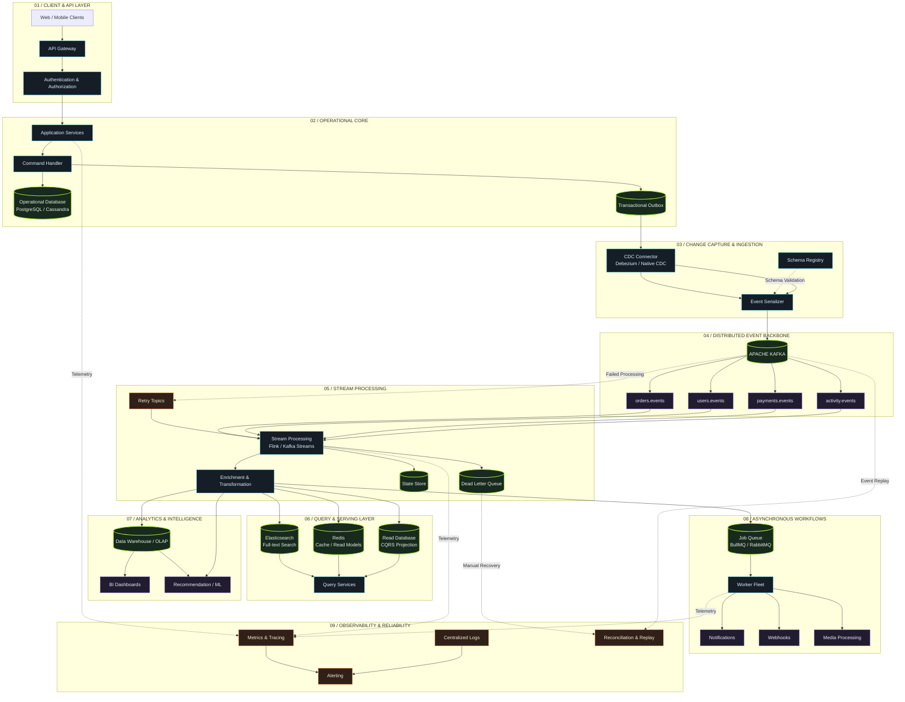

<div align="center">


<br/>

<code>ENGINEERING THE SYSTEMS BEHIND THE SOFTWARE.</code>

<br/><br/>

<a href="https://github.com/SubhraBNayak">

</a>
<a href="www.linkedin.com/in/subhra-bikiran-nayak-438807288">

</a>
<a href="mailto:subhrabikiran@gmail.com">

</a>

<br/><br/>


</div>

---

<table>
<tr>
<td width="60%" valign="top">

## 00 / IDENTITY

# Software is more than its interface.

I'm a Computer Science engineering student focused on backend engineering and the systems that power modern applications.

I enjoy exploring what happens beneath an API: how databases organize information, how services communicate, how concurrent workloads are handled, and how distributed systems recover when things inevitably break.

Currently building with **Node.js and Python**, while exploring **Go, distributed systems and infrastructure engineering**.

</td>
<td width="40%" valign="top">

### SYSTEM PROFILE

```yaml
name: Subhra Bikiran Nayak

domain:
  - Backend Engineering
  - Distributed Systems

building_with:
  - Node.js
  - Python
  - PostgreSQL

exploring:
  - Go
  - Kafka
  - Concurrency
  - System Design

mindset:
  - Fundamentals first
  - Correctness over shortcuts
  - Understand the internals
```

</td>
</tr>
</table>

---

<div align="center">

## 01 / THE ENGINEERING STACK

<sub>A SNAPSHOT OF THE TOOLS I BUILD WITH AND THE SYSTEMS I'M EXPLORING.</sub>

</div>

<table>
<tr>
<td width="50%" valign="top">

### `01. LANGUAGES`


### `02. BACKEND`


### `03. DATA`


</td>
<td width="50%" valign="top">

### `04. INFRASTRUCTURE`


### `05. MESSAGING & SYSTEMS`


### `06. FRONTEND`


</td>
</tr>
</table>

---

<div align="center">

## 02 / SYSTEMS THAT INTEREST ME

<sub>NOT JUST WHAT A TECHNOLOGY DOES. WHY IT EXISTS.</sub>

</div>

<table>
<tr>
<td width="50%" valign="top">

### DISTRIBUTED COMPUTING

- Concurrency and synchronization
- Fault tolerance and recovery
- Consistency and replication
- Message delivery guarantees
- Service discovery and communication

</td>
<td width="50%" valign="top">

### DATA ENGINEERING

- Database internals and indexing
- Query optimization
- Caching strategies
- Change Data Capture
- Event streaming and OLAP

</td>
</tr>
<tr>
<td width="50%" valign="top">

### BACKEND ARCHITECTURE

- API design and scalability
- Asynchronous job processing
- WebSockets and real-time systems
- Authentication and security
- Microservices and gRPC

</td>
<td width="50%" valign="top">

### INFRASTRUCTURE

- Containers and orchestration
- CI/CD and deployment
- Observability and monitoring
- Load balancing
- Linux and networking

</td>
</tr>
</table>

---

<div align="center">

## 03 / AN ARCHITECTURE I LOVE EXPLORING

<div align="center">

<sub>FROM A SINGLE WRITE TO A DISTRIBUTED ECOSYSTEM OF INDEPENDENT SYSTEMS</sub>

</div>



<div align="center">

<sub>ONE WRITE PATH · MULTIPLE READ MODELS · INDEPENDENT CONSUMERS · EVENTUAL CONSISTENCY</sub>

</div>

## 04 / ENGINEERING PRINCIPLES

</div>

```text
┌─────────────────────────────────────────────────────┐
│                                                     │
│  01   Understand the workload before choosing tools.│
│  02   Correctness before optimization.              │
│  03   Design for failure, not just success.         │
│  04   Measure performance instead of guessing.      │
│  05   Prefer simplicity until complexity is needed. │
│  06   Understand the abstraction before using it.   │
│                                                     │
└─────────────────────────────────────────────────────┘
```

---

<div align="center">

## 05 / GITHUB ACTIVITY

<sub>CONTRIBUTIONS, EXPERIMENTS AND THINGS BUILT ALONG THE WAY.</sub>

<br/><br/>


<br/><br/>


</div>

---

<div align="center">

## 06 / OPEN CHANNEL

**Interested in backend engineering, distributed systems and building things that scale.**

<br/>

<a href="https://github.com/SubhraBNayak">

</a>

<br/><br/>

<a href="https://www.linkedin.com/">

</a>
&nbsp;
<a href="mailto:your-email@gmail.com">

</a>

<br/><br/>

<sub>SUBHRA BIKIRAN NAYAK · BUILT ON CURIOSITY, REFINED THROUGH ENGINEERING.</sub>

<br/><br/>


</div>
